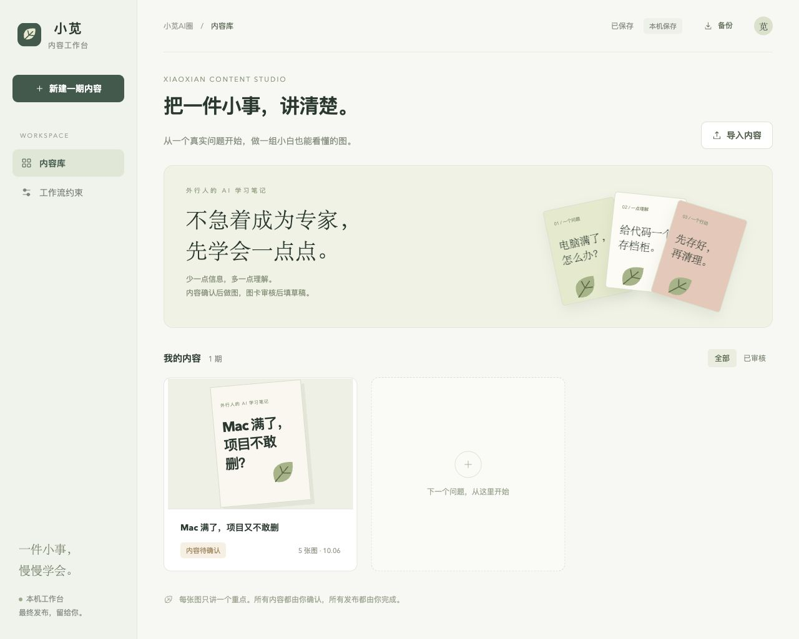
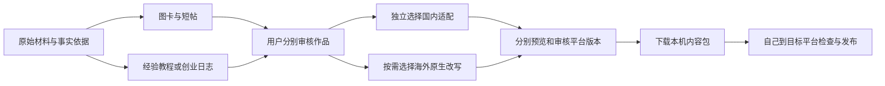
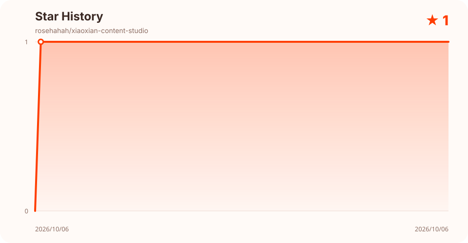

# 小苋内容工作台 · Xiaoxian Content Studio

[](LICENSE)
[](package.json)
[](https://github.com/rosehahah/xiaoxian-content-studio/actions/workflows/ci.yml)
[](https://github.com/rosehahah/xiaoxian-content-studio/stargazers)
[](#contributors-)

一个给个人创作者使用的本机内容工作台：保存原始材料与事实，制作图卡或独立长文，再按需适配国内与海外平台。当前版本默认 **仅本机导出（export-only）**：审核后下载 HTML、图片和 ZIP 内容包，由你在目标平台检查与发布。

远程草稿连接器保留协议实现与模拟测试，尚未完成真实账号和平台验收，默认服务中禁用。存在连接器代码或配置，不代表内容已经写入平台。



## 为什么我做它

我自己就是一个同时维护微信公众号、小红书和抖音的博主。

很多内容最开始只是突然冒出来的一个点子。如果当时没有赶紧记下来、整理出来，过几个小时可能就没有感觉了。但真正准备发布时，我又要反复做这些事情：重新组织文字、制作图卡、改三套标题和说明、检查各平台字数，再去三个创作中心重复上传和粘贴。

灵感可能只花一分钟，后面的搬运却要花很久。事情一多，原本想讲的内容就很容易被拖掉。

所以我做了这个工作台，希望把最麻烦的重复劳动接起来：**先抓住那个点子，把资料、成品和各平台版本留在能继续编辑的项目里；最终发不发、什么时候发，仍然由我决定。**

## 一个故事怎样成为不同平台的内容



长文可以在没有图卡的情况下完成、预览与审核。原文、图卡和平台版本各有审核记录；国内选择不会自动勾选海外，导入 Agent 结果不会替你确认或发布。

## 它主要替我省掉什么

- 原始材料与事实依据保存一次，后续作品引用同一份材料。
- 文章、图卡和各平台稿能重新打开、修改、预览与交付。
- 复制对应创作任务给 Agent，按读者和平台组织内容，再将结果导入。
- 国内成品完成后，按需进入独立海外阶段，重新写英语和图内文字。
- 审核后的内容打包带走，保留目标平台上的最终人工检查。

它适合同时经营多个内容平台的个人博主、个人 IP 和小团队，尤其适合“点子很多，但容易卡在整理与发布流程”的创作者。

## 能力

- 独立封面制作：可视参考、身份与构图分离、多候选生成导入与用户挑选。
- 按主题组织的原创社媒参考，与独立的HTML/SVG教程内页设计。
- 自由编排的 1080 × 1440 HTML 图卡，可导出 PNG 与交付 ZIP。
- 内容确认、逐图审核、版本指纹和上游修改失效机制。
- 独立的经验教程与创业日志编辑器，不依赖图卡、封面或图卡审核。
- 来源、事实、核验状态与图片登记；正文引用绑定事实与素材版本。
- Markdown 安全预览，支持图片/GIF、图注、列表、表格、代码与 375/390/430 宽度切换。
- 完整离线 HTML，以及含 Markdown、登记图片、审核记录和说明的 ZIP。
- Lucide 与 Tabler 共 8,104 个本机 SVG 素材，支持中文同义词搜索。
- 按渠道、内容形式和语言分别保存平台版本；单个平台改稿不会覆盖原文或其他平台稿。
- 本机交付记录、重复导出复用、目标变化后的独立交付记录与手动反馈。
- 远程草稿协议保留在代码与 mock 测试中；默认运行拒绝远程草稿和正式发布。


## 选题策划与账号偏好

第一步“选题与内容”新增策划与正文两个页签。新建一期可沿用账号偏好，选择讲懂概念、照着操作或讨论观点，再复制策划任务到 Codex。多个方向返回页面后，由用户选定并进入正文创作；也可直接编辑已有正文。

侧栏“账号偏好”保存常用受众、口吻、内容方式与视觉偏好，只影响之后新建的内容。偏好保存在本机 `.local-data/account-preferences.json`；静态版保存在当前浏览器。

策划接口：`GET /api/projects/:id/planning-input`、`POST /api/projects/:id/planning-import`、`POST /api/projects/:id/planning-select`；偏好接口：`GET/PUT /api/account-preferences`。写入需使用当前revision，策划导入还需inputFingerprint。导入只保存方向，选择后更新简报并撤销旧审核；已有图卡保留。网页尚未接入自动模型生成。

封面页改为看参考、准备素材、挑选封面三段，默认推荐3张参考，支持展开全部参考。候选生成、导入和选择仍不等于用户审核。

## 独立封面制作

新建内容只需主题，不要求先选真人或风格。侧栏“封面制作”与每期“封面”环节独立开放，正文与内页可以继续推进。

1. **先看图**：默认推荐3张参考，可展开全部9类原创社媒参考，也可上传自己的参考。示例介绍可借鉴的信息结构，不强制按风格分类选题。
2. **准备这期素材**：选择使用本人照片或不使用真人。身份照片与构图参考分开保存；参考中的人物不作为用户身份。
3. **组织封面文案**：主标题默认沿用首图标题，也可独立改写；引题、辅助要点、收益条可选。修改只影响封面，不修改已确认正文。
4. **生成候选**：复制任务到当前Codex对话，内置imagegen根据主题与参考逐张生成默认3张不同构图的候选，保存并导入。
5. **挑选成品**：放大检查脸部、文字、构图和承诺，明确选择“本期封面”。导入不自动选中，选择后仍需整期图卡审核。

参考示例学习自然场景、描边标题、清单、收益条、手绘引导、拼贴与文字主视觉等方法。并非开拍官方模板，不承诺点击率或“爆款”效果。研究与约束见[九组参考拆解](research/社媒封面参考拆解-20261007.md)。用户提供的截图只保留在本机研究目录，不作为公开版权素材打包。

**网页按钮复制执行任务，不会自行调用生图模型。** 生图依赖当前Codex环境的内置图片工具，不需要项目API密钥或第三方skill；工具不可用时如实说明。真人生成前查看照片，缺少可辨认真人时引导上传或改为无真人。不会用随机人物或HTML占位代替本人生成结果。

照片与候选保存在本机项目中，支持PNG/JPEG/WebP，单张6MB以内，最多6张候选。更换身份、参考、封面文字或偏好会使旧候选失效并要求重新生成；仍保留对比。内页配色独立调整，不要求重生封面。旧项目和已确认记录继续兼容。

本机接力接口：

- `GET /api/projects/:id/creative-input` 返回portraitPath、独立referencePath、prompt、inputFingerprint、revision及导入/选择地址。
- `POST /api/projects/:id/cover-import` 接受data/name/inputFingerprint/revision，只追加候选；每次导入使用最新响应revision。
- `POST /api/projects/:id/cover-select` 接受candidateId/revision，只能选当前输入的候选，不产生审核。

逻辑见[creative.mjs](creative.mjs)、[cover-library.mjs](cover-library.mjs)与[封面界面](dist/cover-ui.js)。教程内页继续使用可编辑HTML/SVG，不强制与封面同一种风格。最终发布由用户执行，评审前不创建新tag或release。

## 本机启动

本版在 Node.js 22 验证。本机编辑、预览和导出不需要平台账号或发布凭证。Agent 的页面验收统一使用已安装并连接的 Ego Lite（`ego-browser`），不需要 Google Chrome；远程草稿在默认版本中禁用。

```sh
npm install
npm run build
npm start
```

打开 <http://localhost:4318>。服务只绑定 `127.0.0.1`，不会开放到局域网。macOS 也可以双击 `启动小苋工作台.command`。

本机数据保存在 `.local-data/`，该目录已加入 `.gitignore`：

- `projects.json`：原始材料、事实、文章、图卡、平台版本与审核记录
- `assets/`：登记图片/GIF；按实际字节计算 SHA-256，读取和导出时核对
- `packages/`、`deliveries/`：本机内容包与对应交付记录
- `backups/`：旧 schema 数据首次迁移前的原始备份
- `draft-jobs/`、可选 `overseas-config.json`：保留的连接器协议状态与私有配置；存在它们不代表远程已启用
- 旧 `browser-profiles/` 保留但不再读取或迁移；不搬运旧浏览器令牌

`npm start` 会先构建所需资源。大型图标数据、依赖包和复制的运行模块由 `npm run build` 生成，不再提交到 Git；应用源文件仍保存在 `dist/`，请勿整目录删除。双击启动脚本也只拉起 Ego Lite。

网页不接收平台密码、令牌或公众号密钥，内容包不包含私有配置与原始私有资料。默认导出流程不检查平台凭证，也不调用远程平台。自定义 `STUDIO_DATA_DIR` 时，数据目录同样应放在 Git 忽略范围内。

## 工作流

图卡路线保留选题、封面、内页与逐图审核。新建时也可以直接选择“长文”，或在作品中切换到“长文与平台适配”：

1. **素材**：保存故事、链接、来源与事实核验状态，上传本地图片/GIF。链接本身不等于已读取或核实。
2. **长文**：选择经验教程或创业日志，直接编辑 Markdown，或复制创作任务到 Agent 后导入 JSON。网页没有直接调用生成模型。
3. **预览与审核**：核对事实引用、文字、图片及手机预览，由用户确认当前长文版本。未登记图片或未核实的引用不能用于审核。
4. **国内 / 海外适配**：两组独立选择渠道、形式和语言，只为本轮所选版本准备任务；原文与图卡可分别作为材料。
5. **交付与反馈**：分别审核平台稿，生成本机内容包；反馈手动录入真实评论或指标，不自动抓取平台数据。

长文写作使用项目原创 [xiaoxian-longform](.agents/skills/xiaoxian-longform/SKILL.md)。教程优先使用用户环境中可读的小苋AI圈写作系统与 `real-practice-sop`；日志优先使用 Viral Writer 和中文自然化编辑。外部入口不可用时采用内置简明规则，并记录实际使用的入口或参考方法，不宣称独立 Humanizer 已安装。

完整离线 HTML 将引用的登记图片嵌入文件；ZIP 包含 `article.html`、`article.md`、`assets/`、配文、审核记录和说明。图卡平台版本还需生成并检查对应语言的实际 PNG；LinkedIn 图卡包不等于已经生成 PDF。

更完整的职责、确认和失效条件见 [WORKFLOW.md](WORKFLOW.md)。项目内 Agent Skills 位于 [.agents/skills](.agents/skills)，创作方法和研究取舍见 [research/创作方法研究.md](research/创作方法研究.md)。

## 独立海外阶段与平台边界

常用路径是先完成国内成品，再按需要进入“海外适配”。中文稿、原始资料和证据共同作为输入：先确定目标读者与平台简报，再选择切入、结构和英语表达。不会自动把中文全文翻译后广播到所有海外渠道；图卡版本需要改图内文字并重新排版。

| 平台与形式 | 当前工作台交付 | 远程连接状态 |
| --- | --- | --- |
| 微信公众号长文 / 多图 | 独立长文或图卡内容包 | 普通文章 `news` 与多图 `newspic` 协议分开；均未实账号验收，默认禁用 |
| 小红书 / 抖音图卡 | 图片与配文包 | 旧浏览器草稿适配器仅保留协议测试，默认禁用 |
| 知乎 / 掘金长文 | 独立适配稿与本机包 | 未接通远程正文发布 |
| Substack 长文 | 原生改写稿、HTML / Markdown 和登记图片 | 旧浏览器草稿连接器未实平台验收，默认禁用；公开正文写入 API 未核实 |
| LinkedIn 短帖 / 图卡 | 独立短帖或实际图卡 PNG 包 | 未接通远程；原生 Articles/newsletter 不在当前形式列表中 |
| X 短帖 / 图卡 / Articles | 按形式保存与导出 | 官方 Articles 草稿协议已有实现和测试，未实账号验收，默认禁用 |
| Threads 短帖 / 图卡 | 按语言保存文稿与图片包 | 未接通远程；旧本机队列不代表 Threads 草稿 |

平台的官方 API 能力、本项目协议代码和当前用户账号可用性是三件事。[wechat-article.mjs](wechat-article.mjs) 通过依赖注入实现普通文章草稿的上传、创建与回读协议，没有接入本版的真实账号交付路径。mock 返回成功或拿到草稿编号，也不能证明真实平台渲染和内容已完成验收。

LinkedIn Posts API 的外部文章链接卡片不等于原生 Articles/newsletter 正文。LinkedIn 网站自动化不能用来补未接通的接口。平台规则和格式能力在后续接入时分别核验，使用 Ego Lite 本身不代表平台允许自动操作。

这版只提供 `export` 交付：`draft`、`publish` 和非本机目标请求会被拒绝，旧草稿执行端点也不向真实平台发起操作。接口接受、媒体容器、远程草稿、审核通过、公开发布与邮件发送必须分别记录，`local_ready` 只表示本机包就绪。

### 本机长文接口

所有编辑使用当前 `revision`；Agent 导入同时使用对应任务的 `inputFingerprint`，过期结果返回 409。审核要求用户明确确认，Agent 导入不得写入 `approval` 或交付状态。

| 用途 | 接口 |
| --- | --- |
| 材料与图片 | `PUT /api/projects/:id/sources`、`POST /api/projects/:id/assets` |
| 长文接力与编辑 | `GET /api/projects/:id/article-input`、`POST /api/projects/:id/article-import`、`PATCH /api/projects/:id/article` |
| 阅读预览与用户审核 | `GET /api/projects/:id/article-preview`、`POST /api/projects/:id/article-approve` |
| 独立渠道与平台稿 | `PATCH /api/projects/:id/channels`、`GET /api/projects/:id/variant-input`、`POST /api/projects/:id/variant-import` |
| 平台稿编辑与审核 | `PATCH /api/projects/:id/variants/:variantId`、`POST /api/projects/:id/variants/:variantId/approve` |
| 本机导出与记录 | `GET /api/projects/:id/export?format=html`、`POST /api/projects/:id/deliveries`、`GET /api/deliveries/:id` |
| 反馈 | `PATCH /api/projects/:id/feedback`，通过单项目 GET 回读 |

长文编辑、预览、存储与交付逻辑分别见 [content-domain.mjs](content-domain.mjs)、[article-render.mjs](article-render.mjs)、[content-storage.mjs](content-storage.mjs) 和 [content-delivery.mjs](content-delivery.mjs)。海外写作方法见 [原生改写规则](.agents/skills/xiaoxian-longform/references/overseas-rewrite.md)；外部参考的采用范围记录在[致谢](ACKNOWLEDGEMENTS.md)。

## 开发与验证

```sh
node scripts/preflight.mjs build
npm run build
npm test
npm run test:ci
# 新长文真实 HTTP 集成测试：临时数据、独立端口、默认仅导出
node --test tests/longform-api.test.mjs
# 封面浏览器验收（Ego Lite；仅使用隔离本机数据）
npm run test:cover-ui
npm run test:topics-ui
# 长文、独立海外版本和旧图卡全链路；全程合成隔离数据
npm run test:longform-ui
# 旧草稿界面与协议的模拟测试；不代表实平台可用
npm run test:draft-ui
```

测试覆盖来源依赖、独立审核与失效、任务复用、版本冲突、同源限制、安全 Markdown、GIF/完整离线包、交付幂等和中断恢复。新长文 HTTP 测试使用临时 `STUDIO_DATA_DIR` 与独立端口，显式不设置 `STUDIO_DRAFT_DRIVER`，验证默认远程拒绝路径。

旧连接器协议测试在自己的子进程中设置 `STUDIO_DRAFT_DRIVER=mock`，只校验模拟响应、状态与恢复逻辑；这个开关不是生产连接启用方法。测试不调用真实内容平台。模拟测试通过、结构检查通过与真实账号/浏览器视觉验收需分别报告；跳过或不可用的检查不能记为通过。

CI 只允许六个已声明的 Ego 用例跳过，发行仍需对应提交上的专用浏览器证据。`scripts/package-release.mjs --sha <完整SHA> --output <目录>`从指定提交生成源码候选包和校验清单；`scripts/check-release-package.mjs --help`提供全新安装、默认仅导出、合成旧数据升级与备份回滚验收入口。安装、构建、迁移和打包各自预检磁盘空间，不自动删除用户文件。回滚使用旧包和升级前数据备份，不能用旧代码直接打开schema 2。

## 开源、致谢与贡献者

项目代码、文档和项目内原创 Skills 使用 [Apache License 2.0](LICENSE)。选择它是因为它允许复用与商用，同时包含明确的专利授权、变更说明和贡献条款。

“小苋AI圈”名称、Logo、人物照片和个人形象不在 Apache-2.0 授权范围内，详见 [BRAND.md](BRAND.md)。第三方项目、Agent Skills 和运行时依赖的作者与许可证记录在 [ACKNOWLEDGEMENTS.md](ACKNOWLEDGEMENTS.md) 和 [THIRD_PARTY_NOTICES.md](THIRD_PARTY_NOTICES.md)。

本项目采用 [All Contributors](https://allcontributors.org/en/reference/specification/) 规范，同时承认代码、内容方法、设计思路和工具贡献。GitHub 内置 Contributors 图表仍只反映真实 commit；下方表格展示更完整的贡献类型。提交代码、设计、文档、测试或研究都欢迎，参见 [CONTRIBUTING.md](CONTRIBUTING.md)。

## Contributors ✨

感谢这些创作者、维护者和组织为项目提供代码、内容方法、设计思路或工具。每个符号的含义见 [贡献类型说明](https://allcontributors.org/en/reference/emoji-key/)，具体采用范围和许可证见 [ACKNOWLEDGEMENTS.md](ACKNOWLEDGEMENTS.md)。

<!-- ALL-CONTRIBUTORS-LIST:START - Do not remove or modify this section -->
<table>
  <tr>
    <td align="center" valign="top" width="20%"><a href="https://github.com/rosehahah"><br /><sub><b>Rose Han</b></sub></a><br /><a href="https://allcontributors.org/en/reference/emoji-key/#code" title="Code">💻</a> <a href="https://allcontributors.org/en/reference/emoji-key/#design" title="Design">🎨</a> <a href="https://allcontributors.org/en/reference/emoji-key/#content" title="Content">🖋</a> <a href="https://allcontributors.org/en/reference/emoji-key/#doc" title="Documentation">📖</a> <a href="https://allcontributors.org/en/reference/emoji-key/#maintenance" title="Maintenance">🚧</a></td>
    <td align="center" valign="top" width="20%"><a href="https://github.com/op7418"><br /><sub><b>歸藏</b></sub></a><br /><a href="https://allcontributors.org/en/reference/emoji-key/#ideas" title="Ideas & Planning">🤔</a> <a href="https://allcontributors.org/en/reference/emoji-key/#design" title="Design">🎨</a> <a href="https://allcontributors.org/en/reference/emoji-key/#content" title="Content">🖋</a></td>
    <td align="center" valign="top" width="20%"><a href="https://github.com/whitthose"><br /><sub><b>whitthose</b></sub></a><br /><a href="https://allcontributors.org/en/reference/emoji-key/#ideas" title="Ideas & Planning">🤔</a> <a href="https://allcontributors.org/en/reference/emoji-key/#content" title="Content">🖋</a></td>
    <td align="center" valign="top" width="20%"><a href="https://github.com/adjfks"><br /><sub><b>corner</b></sub></a><br /><a href="https://allcontributors.org/en/reference/emoji-key/#ideas" title="Ideas & Planning">🤔</a> <a href="https://allcontributors.org/en/reference/emoji-key/#content" title="Content">🖋</a></td>
    <td align="center" valign="top" width="20%"><a href="https://github.com/classfang"><br /><sub><b>Junki</b></sub></a><br /><a href="https://allcontributors.org/en/reference/emoji-key/#ideas" title="Ideas & Planning">🤔</a> <a href="https://allcontributors.org/en/reference/emoji-key/#content" title="Content">🖋</a></td>
  </tr>
  <tr>
    <td align="center" valign="top" width="20%"><a href="https://github.com/aaron-he-zhu"><br /><sub><b>Aaron Zhu</b></sub></a><br /><a href="https://allcontributors.org/en/reference/emoji-key/#ideas" title="Ideas & Planning">🤔</a> <a href="https://allcontributors.org/en/reference/emoji-key/#content" title="Content">🖋</a></td>
    <td align="center" valign="top" width="20%"><a href="https://github.com/nashsu"><br /><sub><b>nash_su</b></sub></a><br /><a href="https://allcontributors.org/en/reference/emoji-key/#ideas" title="Ideas & Planning">🤔</a> <a href="https://allcontributors.org/en/reference/emoji-key/#content" title="Content">🖋</a></td>
    <td align="center" valign="top" width="20%"><a href="https://github.com/anthropics"><br /><sub><b>Anthropic</b></sub></a><br /><a href="https://allcontributors.org/en/reference/emoji-key/#ideas" title="Ideas & Planning">🤔</a> <a href="https://allcontributors.org/en/reference/emoji-key/#design" title="Design">🎨</a></td>
    <td align="center" valign="top" width="20%"><a href="https://github.com/nextlevelbuilder"><br /><sub><b>Next Level Builder</b></sub></a><br /><a href="https://allcontributors.org/en/reference/emoji-key/#ideas" title="Ideas & Planning">🤔</a> <a href="https://allcontributors.org/en/reference/emoji-key/#design" title="Design">🎨</a></td>
  </tr>
</table>

<!-- ALL-CONTRIBUTORS-LIST:END -->

## Star History

星标曲线从 GitHub 读取后在本机生成，不会把访问令牌交给第三方服务。维护者可运行 `npm run star-history` 刷新明暗两版 SVG。

<p align="center">
  <picture>
    <source media="(prefers-color-scheme: dark)" srcset="assets/star-history-dark.svg" />
    
  </picture>
</p>

## License

Copyright 2026 Xiaoxian AI Circle contributors.

Licensed under the Apache License, Version 2.0. See [LICENSE](LICENSE) and [NOTICE](NOTICE).

## 联系小苋

项目使用、内容创作或合作交流，可以扫码添加小苋企业微信。

<p align="center">
  
</p>
